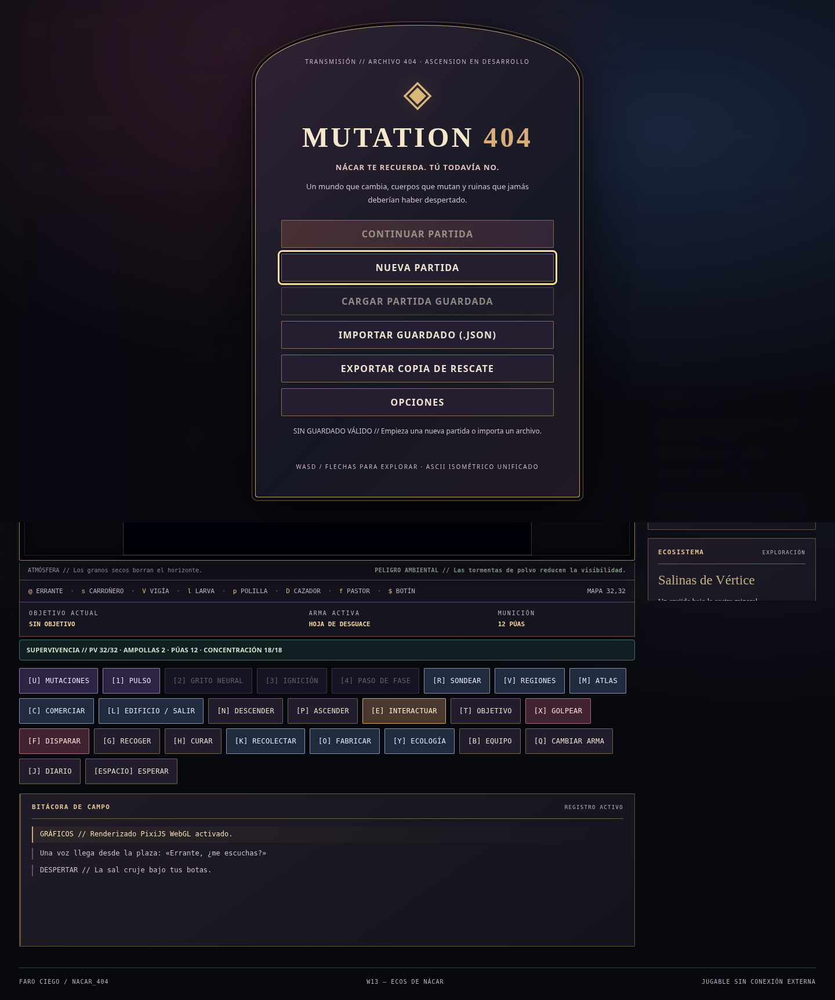
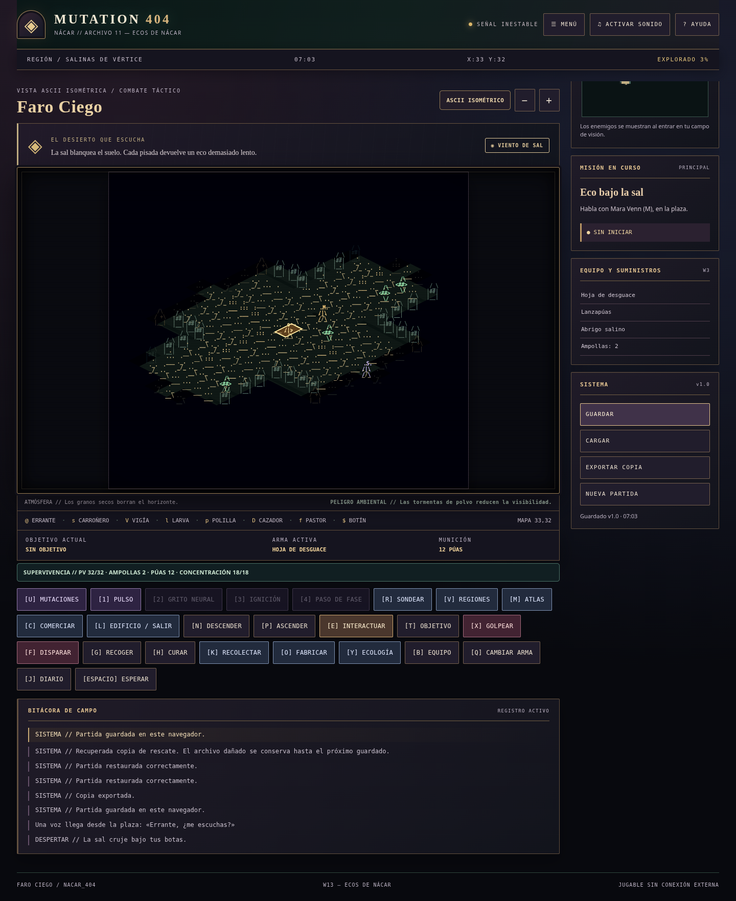

# ASCENSION — santuario gótico

Capturas de la ejecución Chromium de esta entrega, no mockups:

Dirección aplicada a la interfaz: piedra violeta y azul nocturno, bronce envejecido, vino y marfil; luz de vidriera en fondos discretos. Títulos con serif local y datos tácticos monoespaciados. El mundo conserva ASCII isométrico y paletas de sus biomas: no se filtra el canvas para recolorear información jugable.

Menú principal con marco de arco, botones rectangulares, ornamentación discreta y jerarquía tipográfica. Diálogos, inventario, diario, objetivos y controles heredan superficies y bordes coherentes. Puertas, terminales y santuarios tienen remates apuntados mediante caracteres ASCII originales.

## Legibilidad y límites

- Controles principales de al menos 44 px y cierre de diálogo amplio; foco de teclado visible de 3 px.
- Texto y fondo comprobados: cuerpo 14,50:1; botones 12,49:1; secundarios 8,33:1; descripción de menú 8,64:1; botón principal 7,68:1. Cálculo WCAG sobre colores sólidos declarados; no es una auditoría de todas las capas/estados/transparencias.
- Movimiento reducido respetado; adaptación móvil y reglas de colores forzados. Sin CDN, imágenes o fuentes externas.
- Atlas WebGL de 80×80 para alojar cuatro filas sin cortar; se conserva el tamaño lógico y la matriz de escala previa. QA de ataques mide los límites reales del texto en canvas.
- Input nativo de importación oculto; el botón Importar abre el selector existente. La etiqueta del menú identifica ASCENSION en desarrollo.

Las pruebas automáticas verifican controles, guardados, fallback, tamaño móvil y glifos. No acreditan perfección estética, evaluación con lector de pantalla, hardware físico ni una campaña humana completa. Oclusión de todas las capas y coreografía integral siguen como tareas separadas en PROJECT_STATE.md.
