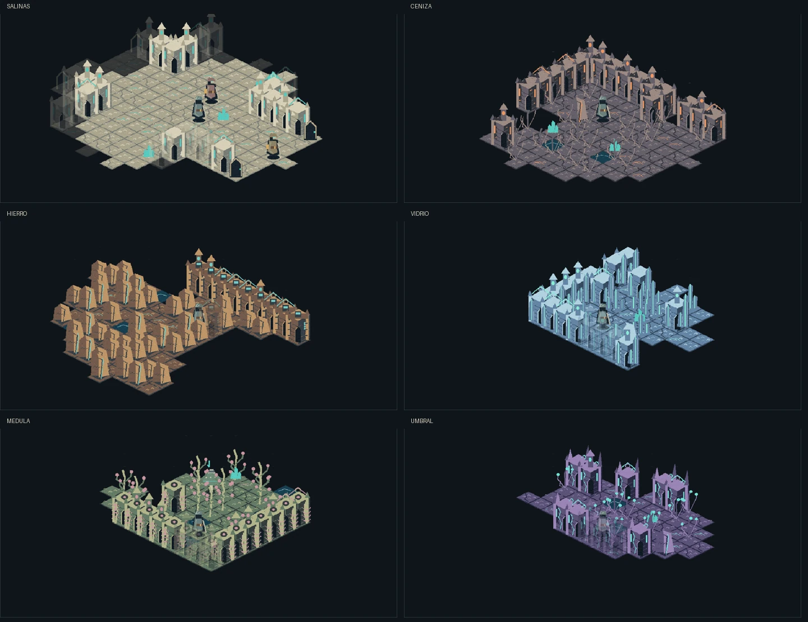

# Nácar — entrega isométrica para revisión

Código validado: `b63262931a6f1adf6cfee318d777664d259a858b`, basado en main `66eac19591e79a5f1cd80259c791994e59056dc1`. Los archivos de evidencia posteriores documentan ese código. PR: https://github.com/ivan7800/MUTATION-404/pull/13.

## Cambios

- Proyección explícita e inversa, personajes verticales con pie común y orden global entre arquitectura y actores. El jugador mantiene una posición estable al hacer zoom.
- Un pintor Canvas compartido con presentación WebGL opcional. El fallback conserva los mismos recursos y la misma perspectiva; ASCII permanece seleccionable.
- Atlas original de 200 sprites: seis variantes de suelo y tres de roca, flora y arquitectura por bioma; Errante en cuatro direcciones y estados; seis especies, élite, jefe, arquetipos NPC y objetos.
- Materiales diferenciados para los seis biomas y selección temática de interiores. Suelo bajo los props, sombras de contacto, niebla y atenuación de arquitectura delante del personaje.
- Animaciones con reloj visual separado, suelo retenido durante animación, efectos diferenciados y marcas del próximo ataque del jefe tomadas de sus coordenadas guardadas.
- CSS consolidado, misión más visible, acciones secundarias plegables, inventario legible, controles móviles y opciones CRT menos invasivas por defecto.
- Precache offline de PNG/JSON y digest dependiente de los recursos; actualización de caché con conservación de guardados.

`packages/core` no tiene modificaciones en la PR. Se conservan los turnos, RNG, campaña, progresión, combate, migraciones y guardados.

## Comprobaciones realizadas

[GitHub Actions, ejecución 42929537716](https://github.com/ivan7800/MUTATION-404/actions/runs/42929537716): **validación correcta**. El despliegue se omite por tratarse de una PR.

| Comprobación | Resultado |
|---|---|
| npm ci, typecheck, lint y build offline | Correctos en CI y en una copia limpia local del commit |
| test:core / npm test | 201 pruebas únicas aprobadas, 0 fallos; ambos comandos ejecutados localmente |
| Auditoría de campaña | 3/3 finales y 12 checkpoints |
| Recorrido general Chromium | 25 escenarios aprobados |
| Biomas | Seis escenas reales generadas sin excepciones |
| Isometría y UI | Recorridos WebGL y Canvas aprobados, paneles, acciones, zoom y móvil |
| Offline | Instalación bajo /MUTATION-404/, recarga sin red, guardado conservado y actualización aplazada hasta cerrar clientes |
| Compatibilidad artística | Alternancia pixel/ASCII y poses de seis especies en ambos backends |
| Regresiones nuevas | Proyección e inversa, profundidad, render sin mutar guardados, suelo retenido e invalidación de caché al cambiar atlas |

Los reportes originales están en [isometric-evidence](isometric-evidence/). Contienen fixtures, coordenadas, resultados y perfil de construcción de escenas. El artefacto `mutation-404-browser-qa` del run conserva los PNG originales. Las imágenes de [screenshots/isometric](screenshots/isometric/) son recortes o versiones comprimidas para revisión.

## Inspección visual

Se abrieron y revisaron mundo inicial, seis biomas, inventario, móvil, interior y jefe. La revisión motivó correcciones de encuadre, espaciado móvil, descripciones del inventario y las marcas del jefe. No se presentan imágenes conceptuales como capturas del juego.

[Mundo](screenshots/isometric/world.webp) · [Menú](screenshots/isometric/menu.webp) · [Inventario](screenshots/isometric/inventory.webp) · [Móvil](screenshots/isometric/mobile.webp) · [Interior](screenshots/isometric/interior.webp) · [Combate](screenshots/isometric/combat.webp) · [Jefe y casillas anunciadas](screenshots/isometric/boss.webp).

## Rendimiento y límites prácticos

Entorno de navegador: Chromium de GitHub Actions con SwiftShader, no GPU física. El recorrido isométrico registró una media de construcción de escena de 0,758 ms en el presentador WebGL y 0,579 ms en Canvas para sus fixtures. El perfil regional mantuvo tres construcciones de suelo mientras aumentaban los frames presentados. Estos valores describen construcción JavaScript; no miden FPS, transferencia de texturas ni tiempo de GPU. No hay una comparación válida con la versión anterior en el mismo hardware.

Una comparación de los PNG WebGL/Canvas del run previo 42928209791 dio diferencias medias por canal inferiores a 0,02/255 en el mismo encuadre. Es evidencia de paridad de ese fixture, no una certificación universal de todos los dispositivos.

La terminal local bloqueó Chromium por restricciones de sockets y la política rechazó la ampliación de permisos; los recorridos reales se ejecutaron en CI. No se certifican GPU física, altavoces, una sesión larga ni una campaña humana completa. Los tres finales se verifican mediante contratos y fixtures reproducibles.

El arte implementado es pixel art geométrico original. Tiene menos densidad pictórica que la imagen conceptual elegida; su aceptación estética debe hacerse sobre estas capturas reales. La PR no equivale a una publicación en main ni a una garantía de ausencia absoluta de bugs.

## Recursos y reproducción

La [guía de arte](ISOMETRIC-ART-GUIDE.md) detalla el inventario. `python3 scripts/art/build_isometric_assets.py` requiere Pillow y genera PNG/JSON. No necesita Pillow en tiempo de juego. Recursos originales escritos para este proyecto, sin sprites de terceros.

Ejecutar los comandos de AGENTS.md. Para navegador: `CHROME_PATH=/ruta/chrome node scripts/qa-browser.mjs`, y los scripts `qa-pixel-biomes.mjs`, `qa-isometric.mjs` y `qa-offline.mjs`. El build estático para Pages se regenera desde las fuentes; no se editaron únicamente los módulos compilados.

## Continuidad

Implementación y comprobaciones funcionales cerradas en el commit indicado. Revisión pendiente: aceptación estética del usuario antes de decidir una fusión. Main permanece sin modificar. Para publicar, revisar la PR y dar una instrucción expresa de fusión/publicación.
